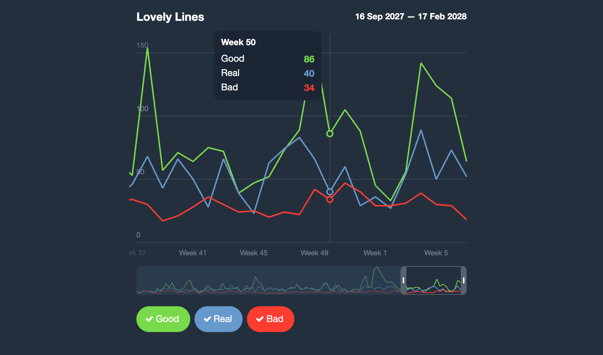

# LovelyChart

<a href="https://www.npmjs.com/package/lovely-chart" target="_blank"></a>
<a href="https://bundlephobia.com/package/lovely-chart" target="_blank"></a>
<a href="https://github.com/Ajaxy/lovely-chart/actions/workflows/ci.yml" target="_blank"></a>

**LovelyChart** is a tiny, dependency-free library of Telegram-style charts that look lovely out of the box: a minimalist design, a refined palette for day and night, and polished interactions.

It draws line, area, bar, step, pie and donut charts with smooth animated transitions, a draggable minimap and a drag across the plot for range selection, tooltips, dataset toggling, drill-down zooming and a built-in day/night theme. Everything is touch-friendly and fast enough for low-end mobile devices.

It draws the statistics of [Telegram Web](https://web.telegram.org/a/) and the portfolio charts of [My Wallet](https://mywallet.io).

🏆 A [Telegram Chart Contest](https://contest.dev/chart-js) award winning library.

**[Examples](https://ajaxy.github.io/lovely-chart/examples/)** · **[Documentation](https://ajaxy.github.io/lovely-chart/guide/)** · [API reference](https://ajaxy.github.io/lovely-chart/guide/api) · [Changelog](CHANGELOG.md)



## Features

- **Six chart types**: line, area, bar, step, pie and donut, stacked or as percentages, mixed in one chart, on two Y axes or as sparklines.
- **Made to explore**: a minimap window to pan and resize, a range selected by a drag across the plot, drill-down zoom into the detail of a day or into a pie of its shares, and keyboard selection.
- **Tooltips that explain**: totals, a previous period with the change against it, notes, or a readout of your own fed by `onTooltipChange`.
- **Annotations**: reference lines, hatched forecast and estimated ranges, and event lines and pins.
- **Themes**: day and night skins, and every colour open to your design tokens, `var()` and `color-mix()` included.
- **Smooth**: animated ranges and zooms, cross-faded updates and loading skeletons in the chart's own shape.
- **Accessible and international**: accessible names, keyboard navigation, reduced motion, localised dates and right-to-left pages.
- **For any stack**: written in TypeScript with its declarations, no dependencies, and a lifecycle of `new`, `update()` and `destroy()` that fits every framework.

## Installation

```bash
npm install lovely-chart
```

Or, without a bundler, from a CDN: see [Installation](https://ajaxy.github.io/lovely-chart/guide/installation#use-it-from-a-cdn).

## Quick start

```js
import LovelyChart from 'lovely-chart';
import 'lovely-chart/LovelyChart.css';

const chart = new LovelyChart(document.getElementById('chart'), {
  title: 'Online Users',
  type: 'line',
  labels: [1735689600000, 1735776000000, /* … */],
  datasets: [
    { name: 'Desktop', color: '#3497ED', values: [1274, 1305, /* … */] },
    { name: 'Mobile', color: '#9ED448', values: [2861, 2914, /* … */] },
  ],
  withMinimap: true,
});

// Replace the data and re-render
chart.update(newData);

// Tear down the chart and detach all listeners
chart.destroy();
```

Try it in the [playground](https://ajaxy.github.io/lovely-chart/examples/?id=playground), or open the project on [StackBlitz](https://stackblitz.com/github/Ajaxy/lovely-chart).

## Documentation

The [documentation site](https://ajaxy.github.io/lovely-chart/guide/) runs every example live. Its pages are Markdown in [`docs/guide`](docs/guide), which GitHub shows too.

| | |
|---|---|
| **Getting started** | [Introduction](docs/guide/introduction.md) · [Installation](docs/guide/installation.md) · [Your first chart](docs/guide/getting-started.md) · [Using with frameworks](docs/guide/frameworks.md) |
| **Core concepts** | [Data format](docs/guide/data.md) · [Chart types](docs/guide/chart-types.md) · [Axes and values](docs/guide/axes.md) · [Dates, time zones and locales](docs/guide/dates.md) |
| **Features** | [Tooltip](docs/guide/tooltip.md) · [Legend](docs/guide/legend.md) · [Minimap and ranges](docs/guide/minimap.md) · [Zoom and drill-down](docs/guide/zoom.md) · [Annotations](docs/guide/annotations.md) · [Updating data and loading](docs/guide/updating.md) · [Events and external control](docs/guide/interaction.md) · [Accessibility](docs/guide/accessibility.md) |
| **Styling** | [Theming and colours](docs/guide/theming.md) · [Layout, sizing and fonts](docs/guide/layout.md) · [Overlays and custom marks](docs/guide/overlays.md) |
| **Reference** | [API reference](docs/guide/api.md) · [CSS variables and classes](docs/guide/css.md) |

The [examples](https://ajaxy.github.io/lovely-chart/examples/) gallery has a live, editable example of every chart type and feature; their code is in [`docs/examples/code`](docs/examples/code).

### For AI assistants

The docs are written to be read by language models as well as by people:

- [`llms.txt`](https://ajaxy.github.io/lovely-chart/llms.txt) indexes every page and example, and [`llms-full.txt`](https://ajaxy.github.io/lovely-chart/llms-full.txt) holds the whole guide in one file.
- Each page is Markdown at its own URL with `.md` added, as [`guide/tooltip.md`](https://ajaxy.github.io/lovely-chart/guide/tooltip.md), and its "Copy page" menu copies it or opens it in Claude or ChatGPT.
- The type declarations of the package document every option, so an editor or a coding agent shows them as the code is written.

## Contributing

See [CONTRIBUTING.md](CONTRIBUTING.md) for local setup and [CHANGELOG.md](CHANGELOG.md) for release notes.

## License

[MIT](LICENSE)
